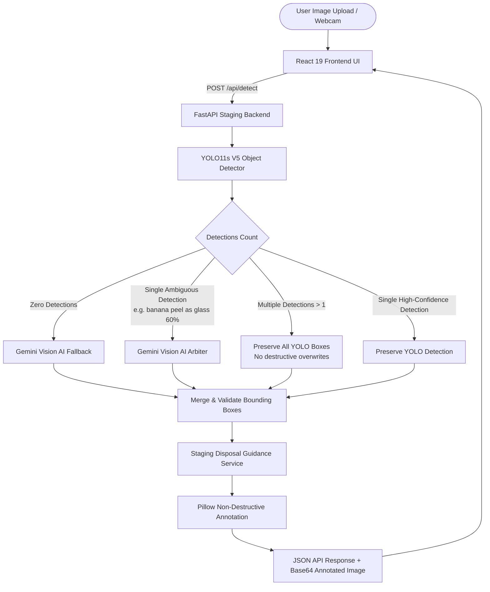

# EcoVision AI — Intelligent Waste Detection & Segregation System

EcoVision AI is an end-to-end computer vision and multimodal AI waste localization and municipal segregation system. Built on a custom-trained **YOLO11s V5** object detection model augmented with a disciplined **Gemini Vision AI** fallback layer, delivered via a high-performance **FastAPI** backend and responsive **React** frontend, EcoVision AI automates the identification and compliant segregation of post-consumer waste.

---

## 1. Project Overview & Key Features

- **7-Class Taxonomy Localization:** Custom-trained YOLO11s V5 model detecting seven waste categories in real time with bounding boxes:
  `plastic`, `metal`, `cardboard`, `glass`, `paper`, `general_trash`, and `organic`.
- **Hybrid Multimodal Vision Layer:** Seamless integration with Google Gemini Vision AI to arbitrate ambiguous single detections (e.g., recovering organic items like banana peels misidentified as glass/plastic) and recover unrepresented waste (e.g., eggshells), while strictly preserving multi-object YOLO detections from destructive overwrites.
- **Municipal Segregation Guidance:** Automatic lookup of solid waste guidelines, providing recommended bin categories (Blue, Green, Black/Grey), preparation steps (e.g. rinsing, flattening, keeping dry), and disposal precautions.
- **Null-Safe Visual Feedback:** Non-destructive image annotation generating color-coded bounding boxes and label badges delivered as base64 PNG data URLs, with comprehensive null-safety for scene-level classifications where coordinates are unavailable.
- **In-Browser Camera Capture & Gamification:** Integrated HTML5 webcam stream, drag-and-drop file upload, and an EcoQuest streak/impact score counter.
- **Configurable Confidence Control:** Fine-tune detection sensitivity with an interactive slider (calibrated default: **15% / 0.15**), balancing recall on difficult waste against background false alarms.
- **One-Click Windows Experience:** Standalone `run_app.bat` launcher that checks dependencies, starts both server processes, and opens the web application.

---

## 2. Technology Stack

| Layer | Technologies |
| :--- | :--- |
| **Machine Learning** | Ultralytics YOLO11s V5, PyTorch (CPU Execution), Torchvision, Pillow, Google Gemini API |
| **Backend API** | FastAPI, Starlette, Uvicorn, Python-multipart, Pydantic |
| **Frontend UI** | React 19, Vite 8, Tailwind CSS v4, Lucide React icons |
| **Environment** | Python 3.12, Node.js (v24), Windows 10/11 |

---

## 3. Supported Class Taxonomy

The active YOLO11s V5 checkpoint (`models/experiments/v5_taxonomy/training/yolo11s_v5_best.pt`) supports the following seven classes:

| Class ID | Class Name | Distinct Color | Recommended Bin | Recyclable? | Common Examples |
| :---: | :--- | :---: | :--- | :---: | :--- |
| `0` | **plastic** | Blue (`#2563EB`) | **Blue Bin** (Dry Recyclables) | Yes | PET bottles, shampoo bottles, clean food containers |
| `1` | **metal** | Amber (`#D97706`) | **Blue Bin** (Dry Recyclables) | Yes | Beverage cans, food tins, aluminium foil |
| `2` | **cardboard** | Brown (`#92400E`) | **Blue Bin** (Dry Recyclables) | Yes | Corrugated boxes, packaging cartons, paperboard |
| `3` | **glass** | Teal (`#0D9488`) | **Glass Bin / Bottle Bank** | Yes | Bottles, jars *(Handle with care; wrap if broken)* |
| `4` | **paper** | Emerald (`#059669`) | **Blue Bin** (Dry Recyclables) | Yes | Newspapers, notebooks, office paper, clean bags |
| `5` | **general_trash** | Crimson (`#E11D48`) | **Black / Grey Bin** (General Waste) | No | Soiled food wrappers, greasy pizza boxes, sanitary waste |
| `6` | **organic** | Green (`#16A34A`) | **Green Bin** (Compost / Wet Waste) | Compostable | Fruit peels, vegetable trimmings, eggshells, leftover food |

---

## 4. Architecture Workflow



---

## 5. Quick Start (One-Click Launch)

To start both the FastAPI backend and Vite React frontend on Windows:

1. Double-click **`run_app.bat`** (or run `.\run_app.bat` from PowerShell / Command Prompt).
2. The launcher automatically verifies the virtual environment, V5 model checkpoint, and frontend dependencies.
3. Two separate terminal windows will launch:
   - **Backend API Server (V5 Staging):** `http://127.0.0.1:8000`
   - **Frontend UI Server (Vite):** `http://127.0.0.1:5173`
4. Your default web browser will automatically open `http://127.0.0.1:5173`.

---

## 6. Manual Setup & Launch

If you prefer to run services manually in separate terminals:

### Step 1: Start Backend Server
```powershell
.venv\Scripts\python.exe -m uvicorn main:app --host 127.0.0.1 --port 8000 --app-dir models/experiments/v5_taxonomy/preproduction/staging/backend
```
- API Base URL: `http://127.0.0.1:8000`
- Interactive Swagger UI: `http://127.0.0.1:8000/docs`
- Health check: `http://127.0.0.1:8000/api/health`

### Step 2: Start Frontend Client
```powershell
cd frontend
npm run dev -- --host 127.0.0.1 --port 5173
```
- Web Application: `http://127.0.0.1:5173`

---

## 7. API Reference

### Health & Readiness
`GET /api/health`
- **Response:**
  ```json
  {
    "status": "healthy",
    "environment": "staging",
    "api_version": "5.0.0-staging",
    "model_loaded": true,
    "model_path": "models/experiments/v5_taxonomy/training/yolo11s_v5_best.pt",
    "target_resolution": 800,
    "classes_count": 7,
    "classes": ["plastic", "metal", "cardboard", "glass", "paper", "general_trash", "organic"],
    "disposal_service_loaded": true
  }
  ```

### Waste Detection
`POST /api/detect`
- **Request Type:** `multipart/form-data`
- **Parameters:**
  - `file`: Image file (JPEG, PNG, WEBP, BMP, TIFF; max 15 MB)
  - `conf`: Confidence threshold float (`0.0 < conf <= 1.0`, default `0.15`)
  - `iou`: IoU threshold for NMS (`0.0 <= iou <= 1.0`, default `0.45`)
  - `imgsz`: Inference resolution integer (`32 <= imgsz <= 2048`, default `800`)
  - `agnostic_nms`: Class-agnostic NMS boolean (default `true`)

---

## 8. Verification & Baseline Preservation

EcoVision AI maintains strict regression verification across representative benchmark test images:

1. **Plastic Bottle (`gw_plastic1002`):** Verified single plastic detection (`conf = 0.9395`).
2. **Glass Bottle (`gw_glass1000`):** Verified single glass detection (`conf = 0.8033`).
3. **Organic Multi-Object Scene (`gw_biodegradable1225`):** 43 organic detections strictly preserved without fallback overwrite.
4. **General Trash (`taco_000000`):** Verified general_trash detection.
5. **Organic Multi-Object Scene (`gw_biodegradable1194`):** 14 organic detections strictly preserved without fallback overwrite.
6. **Real Eggshells:** Verified Gemini Vision AI fallback recovery for unrepresented waste (`organic 0.99`, Green Bin).
7. **Real Banana Peel:** Verified Gemini Vision AI arbitration resolving ambiguous YOLO classification (`organic 0.95–0.98`, Green Bin).
