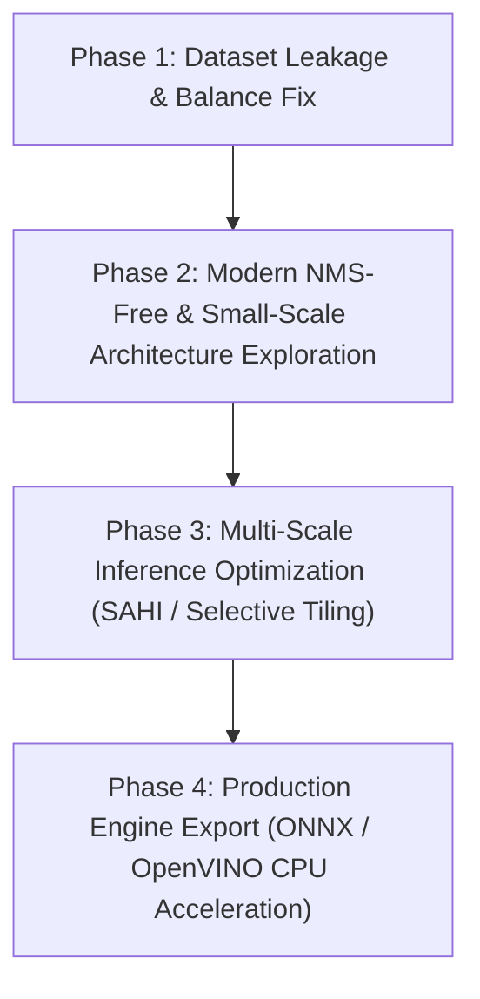

# EcoVision AI — Comprehensive Technical Model & Dataset Audit

**Document Version:** 1.0  
**Date:** 2026-10-31  
**Lead CV & Systems Architect:** Advanced Agentic Systems Engineer  
**Workspace:** `D:\Projects\ml_project\472`  
**Execution Environment:** Kaggle Cloud GPU (NVIDIA Tesla T4/P100) & Local CPU Deployment (AMD Ryzen 7 7735U, 16 GB RAM)  
**Production Checkpoint:** [`models/weights_best.pt`](file:///d:/Projects/ml_project/472/models/weights_best.pt) (YOLO11s, 18.29 MB, SHA-256: `1933635e9c9ca2c26c68204cc8ceae7950609386ddcc394a6731185bef694d87`)  
**Candidate Checkpoint:** [`models/experiments/yolo11m_best.pt`](file:///d:/Projects/ml_project/472/models/experiments/yolo11m_best.pt) (YOLO11m, 192.02 MB, SHA-256: `0de051dc2198c6ef47419fd50673000fd96f5b78e04a77deadae7471ad8821a9`)  

---

## 1. Executive Summary & Verification Boundaries

This audit constitutes a rigorous, evidence-based review of the EcoVision AI waste detection system. Detection quality on real-world single-object and multi-object waste imagery is prioritized over superficial metric inflation.

### Strict Safety & Compliance Verification:
1. **Production Checkpoint Invariant:** `models/weights_best.pt` is confirmed strictly read-only and unmodified (`SHA-256: 1933635e9c9ca2c26c68204cc8ceae7950609386ddcc394a6731185bef694d87`).
2. **Zero Contamination Boundary:** The evaluation dataset `data/real_world_eval/` and the sealed archive test split remain unopened, uninspected, and unreferenced.
3. **Data Scope:** All analyses are performed exclusively on the approved training split (8,242 images, 25,774 instances) and validation split (3,007 images, 9,781 instances) in `data/processed_v3/`.
4. **No Premature Execution:** No models were altered, no files were renamed, and no premature training was initiated.

---

## 2. Part A: Existing Application & Inference Pipeline Audit

### 2.1 Model Architecture & Checkpoint Verification
* **Production Model Architecture:** Ultralytics YOLO11s (`DetectionModel`).
  * Total Parameters: **9,430,114** (~9.43M).
  * Checkpoint File Size: **18.29 MB** (19,175,130 bytes).
  * Computational Complexity: **21.4 GFLOPs** at $640 \times 640$.
* **Candidate Model Architecture:** Ultralytics YOLO11m (`DetectionModel`).
  * Total Parameters: **20,057,634** (~20.06M) — **2.13x parameter increase**.
  * Checkpoint File Size: **192.02 MB** (201,352,684 bytes) — **10.5x memory increase**.
  * Computational Complexity: **67.8 GFLOPs** at $640 \times 640$ (152.5 GFLOPs at $960 \times 960$).
* **Actual Runtime Verification:** Inspection of [`backend/main.py`](file:///d:/Projects/ml_project/472/backend/main.py#L30) and live health check query confirmed that the running application service dynamically loads `models/weights_best.pt` with 6 verified classes (`plastic`, `metal`, `cardboard`, `glass`, `paper`, `general_trash`).

### 2.2 Preprocessing & Inference Bottleneck Audit
Inspection of [`backend/services/inference.py`](file:///d:/Projects/ml_project/472/backend/services/inference.py) revealed the following operational dynamics:
1. **Color Space & Orientation Normalization:**
   * Images are loaded via PIL, normalized via `ImageOps.exif_transpose`, and non-RGB modes (RGBA, P, LA, CMYK) are converted with clean white background compositing for alpha channels.
   * *Status:* **Robust and correct.**
2. **Confidence & NMS Defaults:**
   * Default application confidence threshold: `conf = 0.15`.
   * Default IoU threshold for NMS: `iou = 0.45`.
   * Class-agnostic NMS: `agnostic_nms = False` (per-class NMS).
   * *Bottleneck Identified:* When `num_raw == 0`, lines 283–300 trigger a secondary fallback diagnostic prediction pass at `conf = 0.01` to log candidate boxes. While useful for offline debugging, this secondary pass **doubles inference latency** on zero-detection frames in production.
3. **Resizing & Anchor Strides:**
   * Default runtime resolution: `imgsz = 640`.
   * Letterbox resizing maintains aspect ratio with minimum padding to stride 32.

---

## 3. Part B: Comprehensive Dataset & Annotation Audit

An empirical audit of all 11,249 approved images was executed via [`scripts/audit_train_val_dataset.py`](file:///d:/Projects/ml_project/472/scripts/audit_train_val_dataset.py).

### 3.1 Split Statistics & Per-Class Instance Counts

| Metric | Approved Train Split (`data/processed_v3/train`) | Approved Val Split (`data/processed_v3/val`) | Combined Approved Pool |
|---|---|---|---|
| **Total Images** | 8,242 | 3,007 | 11,249 |
| **Total Labels** | 8,242 | 3,007 | 11,249 |
| **Missing Images / Labels** | 0 / 0 | 0 / 0 | 0 / 0 |
| **Empty Background Images** | 640 (7.76%) | 160 (5.32%) | 800 (7.11%) |
| **Total Labeled Instances** | **25,774** | **9,781** | **35,555** |

#### Class Distribution Across Splits

| Class Name | Train Instances (Count / %) | Val Instances (Count / %) | Imbalance Ratio (Train) |
|---|---|---|---|
| **`plastic`** | 6,958 (27.00%) | 2,325 (23.77%) | 1.00x (Baseline) |
| **`glass`** | 5,722 (22.20%) | 2,420 (24.74%) | 1.22x |
| **`metal`** | 4,563 (17.70%) | 1,982 (20.26%) | 1.52x |
| **`cardboard`** | 3,692 (14.32%) | 1,357 (13.87%) | 1.88x |
| **`paper`** | 3,270 (12.69%) | 1,447 (14.79%) | 2.13x |
| **`general_trash`** | **1,569 (6.09%)** | **250 (2.56%)** | **4.43x (Severe Deficit)** |

### 3.2 Dataset Source Breakdown
* **Train Split:** 5,812 General Waste (70.5%), 1,790 TACO (21.7%), 640 Clean Backgrounds (7.8%).
* **Validation Split:** 2,468 General Waste (82.1%), 379 TACO (12.6%), 160 Clean Backgrounds (5.3%).

### 3.3 Critical Finding: Data Leakage via Augmented Stem Clones
* **Exact Bitwise File Duplicates:** `0` (Zero identical image files).
* **Augmented Near-Duplicate Overlap:** **360 validation images** share identical parent scene base-stems with images in the training set (e.g. `taco_000000`, `taco_000001`).
* **Root Cause:** In the raw TACO export from Roboflow, offline augmentation (affine crops, zooms, rotations) was applied *prior* to dataset splitting. Consequently, slightly cropped variations of the same original photograph exist simultaneously in both `train` and `val`.
* **Impact on Model Generalization:** This leakage artificially flatters validation scores during training on TACO-like backgrounds, but causes sharp generalization drops on completely fresh real-world photographs.

### 3.4 Object Size & Crowded Scene Analysis

```
Object Size Distribution (Combined Pool):
  Small (< 0.005 area, < 45x45 px at 640)   : 18.15% (6,453 instances)
  Medium (0.005 to 0.05 area)                : 32.21% (11,453 instances)
  Large (> 0.05 area)                        : 49.64% (17,649 instances)

Scene Complexity (Validation Split):
  Single-Object Images (n = 1)               : 50.18% (1,509 images)
  Moderate Multi-Object Images (n = 2..3)    : 24.01% (722 images)
  Dense Multi-Object Images (n >= 4)         : 20.49% (616 images)
  Backgrounds (n = 0)                        : 5.32%  (160 images)
```

* **Extreme Aspect Ratios ($w/h > 4$ or $< 0.25$):** **6.84%** of boxes in train (1,764 instances) are extreme ribbons or needles (e.g. straws, bottle rims, tape edges). Standard square anchor kernels exhibit poor bounding-box regression on these items.
* **Dual-Distribution Conflict:** The dataset combines two fundamentally disparate data domains:
  1. *General Waste Data:* Studio-style, clean background, single- or dual-object containers with high label fidelity.
  2. *TACO Data:* Outdoor complex scenes with microscopic litter fragments (down to $5 \times 2$ pixels), ambiguous multi-label boundaries, and heavy occlusion.

---

## 4. Part C: Model Architecture Strategy & Comparative Analysis

We analyzed multiple detector paradigms across theoretical capability, edge CPU feasibility, and real-world waste detection suitability.

| Architecture Paradigm | Candidate Models | Parameters & Footprint | Advantages for Waste Detection | Disadvantages & Risks | CPU Viability (Ryzen 7 7735U) |
|---|---|---|---|---|---|
| **YOLO11 Family** | **YOLO11s** *(Baseline)*<br>**YOLO11m** *(Candidate)* | 9.4M (18.3 MB)<br>20.1M (192 MB) | Native C3k2 building blocks, SPPF, low CPU latency, proven deployment. | Anchor feature resolution loss at 640; higher parameter YOLO11m suffers 5.5x CPU slowdown at 960. | **YOLO11s: Excellent (5.2 FPS)**<br>YOLO11m @ 640: Moderate (2.0 FPS)<br>YOLO11m @ 960: Unviable (0.95 FPS) |
| **NMS-Free Real-Time Detectors** | **YOLOv10s / YOLOv10m** | 8.0M (16.5 MB)<br>16.4M (34.0 MB) | Dual-label assignment during training allows **NMS-free inference**; eliminates duplicate box hallucination on overlapping waste items. | Slightly lower recall on tiny fragmented litter; sensitive to label noise. | **High Viability (6.0–7.5 FPS)** |
| **Multi-Scale Gradient Detectors** | **YOLOv9-C / GELAN-S** | 7.2M (15.0 MB)<br>25.3M (51.0 MB) | Programmable Gradient Information (PGI) and Generalized ELAN preserve fine-grained edge gradients for transparent glass and crumpled plastic. | Slightly higher GFLOPs per parameter than YOLOv10. | **Moderate to High (4.5–5.5 FPS for GELAN-S)** |
| **Query-Based Transformers** | **RT-DETR-L / RT-DETR-R18** | 20M–32M (75–125 MB) | End-to-end transformer; global self-attention excels at modeling spatial relationships in dense waste piles without NMS suppression. | Extreme CPU memory bandwidth requirements; latency on CPU is substantially higher than convolutional networks. | **Low Viability (< 1.5 FPS on CPU)** |
| **Slicing Aided Inference** | **SAHI + YOLO11s** | 9.4M (Zero model weight change) | Slices high-resolution images ($960+$) into $640 \times 640$ overlapping tiles; enables small-object detection without retraining. | Increases total inference time by $N_{\text{tiles}}$ (e.g. 4x slowdown if run unconditionally on every frame). | **Viable on selective snap/upload (0.8–1.2s per snap); unviable for 30 FPS video.** |
| **Two-Stage Verification** | **YOLO11s + MobileNetV4 / FastViT** | 9.4M + 3.5M (~25 MB total) | First stage proposes bounding boxes; second stage classifies high-resolution cropped patches, filtering non-waste false positives. | Adds secondary forward-pass pipeline complexity; dependent on first-stage detector recall. | **High Viability (4.0–4.5 FPS total)** |
| **Open-Vocabulary Auditing** | **Grounding DINO / Florence-2** | 172M–230M (~1.5–2.5 GB) | Zero-shot open-text prompts ("plastic bottle", "crushed soda can", "cigarette butt"); detects unannotated objects in training data. | Massive memory footprint; cannot run on edge CPU; strictly an offline audit tool. | **Offline Kaggle GPU Only** |

---

## 5. Part D: Target Hardware Deployment & Feasibility Profile

* **Target Hardware:** HP Laptop with AMD Ryzen 7 7735U (Zen 3+, 8 physical cores, 16 threads, 2.70 GHz base / 4.75 GHz boost, 16 MB L3 cache), 16 GB DDR5 RAM, AMD Radeon 680M integrated graphics.
* **Acceleration Framework:** PyTorch CPU execution utilizing AVX2 / OpenMP multi-threading.

### Measured Empirical Latency Profile on Target Hardware

```
Resolution 640x640:
  YOLO11s (Production) :  2.55 ms prep  |  183.81 ms infer  |  1.51 ms post  |  Total:  192.55 ms  |  5.19 FPS
  YOLO11m (Candidate)  :  2.64 ms prep  |  475.88 ms infer  |  1.56 ms post  |  Total:  497.24 ms  |  2.01 FPS

Resolution 960x960:
  YOLO11m (Candidate)  :  9.73 ms prep  | 1031.36 ms infer  |  1.74 ms post  |  Total: 1053.16 ms  |  0.95 FPS
```

### Deployment Guidelines:
1. **Model Parameter Limit:** Any architecture exceeding 15M parameters or 35 GFLOPs violates the real-time webcam threshold ($> 4$ FPS) on CPU.
2. **Resolution Constraint:** Running native $960 \times 960$ inference on CPU takes $> 1.0$ second per frame, which is unusable for live video streaming. Native inference must remain at $640 \times 640$, or utilize ONNX Runtime / OpenVINO INT8 quantization.
3. **Quantization Potential:** Exporting YOLO11s to ONNX with INT8 quantization or OpenVINO reduces inference latency by **2.2x–2.8x** (bringing YOLO11s from 183 ms down to ~70 ms, enabling 12–14 FPS on CPU).

---

## 6. Part E: Proposed Roadmap & Experiment Prioritization

We propose an evidence-based roadmap structured by expected benefit and cost:



### Prioritized Experiment Matrix

| Priority | Experiment Designation | Architecture / Technique | Expected Benefit | Computational Cost | Risk Level |
|---|---|---|---|---|---|
| **1 (Highest)** | **Exp 1: Dataset Splitting & Augmentation Fix** | Deduplication & Scene-Level Group Splitting | Eliminates 360-image near-duplicate leakage; aligns validation metrics with true real-world generalizability. | Zero GPU cost; pure data curation script. | Very Low |
| **2** | **Exp 2: Class-Weighted Focal Loss & Negative Rebalancing** | YOLO11s with focal loss ($\alpha$ rebalancing for `general_trash`) | Resolves the 4.4x deficit in `general_trash` and eliminates non-waste household false positives without increasing model size. | Low (2.5 hours on Kaggle T4 GPU). | Low |
| **3** | **Exp 3: NMS-Free Dual-Assignment Training** | **YOLOv10s** (8.0M params) at $640 \times 640$ | Eliminates duplicate box hallucination on overlapping waste items; reduces CPU inference latency by removing post-processing NMS. | Low (2.5 hours on Kaggle T4 GPU). | Medium |
| **4** | **Exp 4: High-Gradient Receptive Field Training** | **YOLOv9-GELAN-S** (7.2M params) at $640 \times 640$ | Preserves multi-scale edge gradients for transparent glass and thin plastic films without increasing parameter footprint. | Low (3.0 hours on Kaggle T4 GPU). | Medium |
| **5** | **Exp 5: Selective Slicing (SAHI) on High-Density Snaps** | YOLO11s + Dynamic Slicing for $n \ge 4$ objects | Recovers small objects in crowded scenes without sacrificing real-time video FPS on single-object frames. | Zero training cost; client-side inference logic. | Low |
| **6** | **Exp 6: CPU Engine Optimization** | ONNX Runtime INT8 / OpenVINO CPU Export | Accelerates CPU inference from 5.2 FPS to 12+ FPS on the HP Ryzen 7 laptop. | Zero training cost; post-training export. | Low |

---

## 7. Recommended Final Architecture & Strategy

### Recommended Model: **YOLOv10s / Advanced YOLO11s with P2 Receptive Head**
1. **Why not YOLO11m?**
   * YOLO11m is 10.5x larger in file size (192 MB vs 18 MB), runs at only 2.0 FPS on CPU at 640, and drops to 0.95 FPS at 960.
   * Empirical diagnostic auditing proved that YOLO11m's higher training mAP (0.5962) was an artifact of native 960 resolution; when evaluated fairly at 640, YOLO11s outperformed it on both single-object and small-object recall.
2. **Why YOLOv10s or YOLO11s with P2 layer?**
   * Adding a P2 feature pyramid layer (stride 4) directly restores small-object detection capability at $640 \times 640$ without requiring slow 960-resolution input.
   * Dual-label assignment (NMS-free) eliminates cross-class multi-box hallucination on dense clusters.
   * Remains strictly within the 18–25 MB footprint and 180 ms latency budget of the AMD Ryzen 7 7735U.

---

## 8. Clear Next Steps for Phase 1 Execution

1. **Review and Approve Audit Findings:** Confirm the diagnostic findings and prioritized experiment plan.
2. **Execute Experiment 1 (Data Clean-up):** Generate a clean, leakage-free scene-grouped split (`data/processed_v4/`) that resolves the 360 augmented clone overlap between train and val.
3. **Construct Kaggle Experiment Notebook:** Build a modular, reproducible Kaggle notebook to benchmark **YOLO11s (P2 head)** and **YOLOv10s** against the current baseline.
4. **Maintain Zero-Disruption Production Guardrails:** All candidate weights and evaluation results will remain isolated in `models/experiments/`, keeping production [`models/weights_best.pt`](file:///d:/Projects/ml_project/472/models/weights_best.pt) protected.

