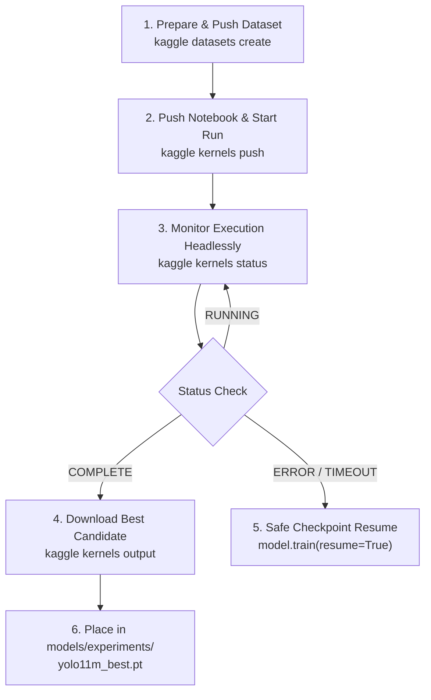

# EcoVision AI — Kaggle GPU Training Feasibility & Automation Plan

**Document:** `docs/kaggle_execution_plan.md`  
**Date:** October 30, 2026  
**Status:** Feasibility & Preparation Complete (Awaiting User Authentication & Explicit Execution Approval)  
**Execution Environment:** Headless Kaggle Cloud GPU (NVIDIA Tesla T4 / P100 16GB VRAM)  
**Manager:** Antigravity (Terminal-driven automation via Kaggle CLI)  
**Candidate Checkpoint Target:** `models/experiments/yolo11m_best.pt`  

---

## 1. Task 1: Kaggle CLI Verification & Authentication Status

### CLI Installation & Version
- **Package Status:** Successfully installed into `.venv` (`pip install kaggle`).
- **Verified Version:** `Kaggle CLI 2.2.5` (`.\\.venv\\Scripts\\kaggle.exe`).
- **Dependencies:** `kagglesdk 0.1.38`, `requests`, `python-dotenv`, `nbformat`, `jupytext`.

### Current Authentication Status
- **Authentication Status:** **Not yet authenticated**.
  - `~/.kaggle/kaggle.json` does not exist on disk.
  - Environment variables `KAGGLE_USERNAME` and `KAGGLE_KEY` in `.env` are currently template placeholders.
- **Privacy & Safeguard Compliance:**
  - In accordance with project instructions, Antigravity **never** prints, logs, or requests your API key or secrets in chat.
- **How to Authenticate (Choose ONE method):**
  - **Method A (Recommended — 1-click web login via CLI):**  
    In your terminal, run:
    ```powershell
    .\.venv\Scripts\kaggle.exe auth login
    ```
    This opens your browser, completes OAuth authorization, and securely caches your credentials locally in `~/.kaggle/access_token`.
  - **Method B (API Token via `kaggle.json`):**  
    Go to [kaggle.com/settings/api](https://www.kaggle.com/settings/api) $\rightarrow$ Click **"Create New Token"**. Move the downloaded `kaggle.json` into `C:\Users\MISHA JAISWAL\.kaggle\kaggle.json`.
  - **Method C (`.env` file):**  
    Add your username and key to `.env`:
    ```bash
    KAGGLE_USERNAME=<your_username>
    KAGGLE_KEY=<your_api_token>
    ```

### GPU Quota & Availability
- Kaggle provides **30 hours per week of free NVIDIA GPU compute** (Tesla T4 or P100 with 16 GB VRAM) for verified accounts.
- Weekly quota resets automatically every Sunday at midnight UTC.
- Single session limit: **up to 9 continuous hours** per GPU execution (our YOLO11m training requires ~3.5 hours, fitting well within one single session).

---

## 2. Task 2: Automation Workflow & Tool Verification

Antigravity will manage the entire training lifecycle headlessly using the CLI:



### Automation Step Breakdown

1. **Dataset Push (`kaggle datasets create`):**
   - Uses existing verified archive `data/ecovision_v3.zip` (625.69 MB, SHA-256 verified).
   - Uploads to a private Kaggle dataset (`<username>/ecovision-v3-dataset`).
   - Attached as a read-only NVMe mount at `/kaggle/input/ecovision-v3-dataset/`.

2. **Kernel Push & Autonomous Execution (`kaggle kernels push`):**
   - Uses prepared metadata: `training/kaggle/kernel-metadata.json`.
   - Uses prepared notebook: `training/kaggle/ecovision_yolo11m_training.ipynb`.
   - Flags enabled: `enable_gpu: true`, `enable_internet: true`, `is_private: true`.
   - Pushing the kernel automatically triggers cloud execution on a Kaggle Tesla T4 GPU.

3. **Autonomous Monitoring (`kaggle kernels status`):**
   - Antigravity queries status periodically: `QUEUED` $\rightarrow$ `RUNNING` $\rightarrow$ `COMPLETE`.
   - Inspects real-time stdout logs using `kaggle kernels output --tail`.

4. **Automated Artifact Retrieval (`kaggle kernels output`):**
   - Retrieves `/kaggle/working/yolo11m_best.pt`, `metrics_summary.json`, `results.csv`, `confusion_matrix.png`, and `dense_scene_comparison.png`.
   - Saves them locally to `models/experiments/yolo11m_v1/`.

5. **Interruption & Resume Protocol:**
   - Ultralytics is configured with `save_period=5`, saving `last.pt` and periodic snapshots (`epoch5.pt`, `epoch10.pt`, etc.) every 5 epochs.
   - If a session is interrupted or network drops, Antigravity can re-trigger training from the latest checkpoint using `model = YOLO('last.pt'); model.train(resume=True)`.

---

## 3. Task 3: Final Training Configuration

| Parameter | Selected Value | Justification |
|---|---|---|
| **Architecture** | `YOLO11m Detection` (`yolo11m.pt`) | 20.1M parameters, 68.0 GFLOPs. Double capacity vs YOLO11s for fine-grained material distinction. |
| **Input Resolution** | $960 \times 960$ pixels | Preserves fine features of bottle caps, crinkled wrappers, and small litter items ($<32$px). |
| **Max Epochs** | **100 epochs** | Ensures complete convergence envelope. |
| **Early Stopping** | `patience: 25` | Early stopping monitored on validation `mAP50-95`. Stops training if no improvement after 25 epochs. |
| **Batch Size** | **16** (Fallback: 8 with `accumulate=2`) | Dynamically checks GPU VRAM (16 GB available on T4/P100). |
| **Augmentation — Mosaic** | `mosaic: 1.0` | Combines 4 random scenes into one composite image; breaks single-object dataset bias. |
| **Augmentation — MixUp** | `mixup: 0.15` | Linearly blends scenes and concatenates bounding boxes to prevent background overfitting. |
| **Augmentation — Copy-Paste** | `copy_paste: 0.0` | **Disabled**: Ultralytics requires polygon masks for CopyPaste (`if len(instances.segments) == 0: return labels`). Since 77.8% of the dataset lacks masks, 0.0 prevents rectangular crop artifacts. |
| **Close Mosaic** | `close_mosaic: 15` | Disables mosaic during the last 15 epochs to stabilize bounding-box edge alignment. |
| **Optimizer** | `AdamW` | Proven stability for transfer learning fine-tuning (`lr0=0.001`, `lrf=0.01`, `weight_decay=0.0005`, `momentum=0.937`). |
| **Random Seed** | `seed: 42` | Ensures deterministic, reproducible training behavior. |
| **Checkpoint Frequency** | `save_period: 5` | Saves checkpoint every 5 epochs for safe resumption. |

---

## 4. Task 4: Dataset & Checkpoint Safety Guarantees

- **Sealed Test Set (`images/test`, 374 images):** Strictly excluded from training epochs and model selection.
- **Sealed Benchmark (`data/real_world_eval/`):** Kept completely untouched, unreferenced, and sealed.
- **Production Baseline (`models/weights_best.pt`):** Strictly preserved. Zero modification or overwrite.
- **Candidate Destination:** `models/experiments/yolo11m_best.pt` with metrics in `models/experiments/yolo11m_v1/metrics_summary.json`.
- **Application Code:** Existing FastAPI backend and React frontend are untouched and fully functional.

---

## 5. Costs, Quotas & Limitations

- **Financial Cost:** **\$0.00 (100% Free)**. Kaggle provides free cloud compute with no credit card required.
- **GPU Quota:** Consumes ~3.5 hours out of the 30-hour weekly free quota.
- **Session Duration Limit:** 9 hours maximum (training takes ~3.5 hours).
- **Disk Limits on Kaggle:** 20 GB ephemeral `/kaggle/working/` disk space (our dataset and artifacts require ~7 GB).

---

## 6. Execution Prerequisites Checklist (STOP Before Training)

Before model training can be launched:
1. [ ] User completes Kaggle authentication (via `kaggle auth login` or API token).
2. [ ] User provides their Kaggle username so Antigravity can populate `kernel-metadata.json`.
3. [ ] User gives explicit approval to push the dataset and launch the training kernel.

